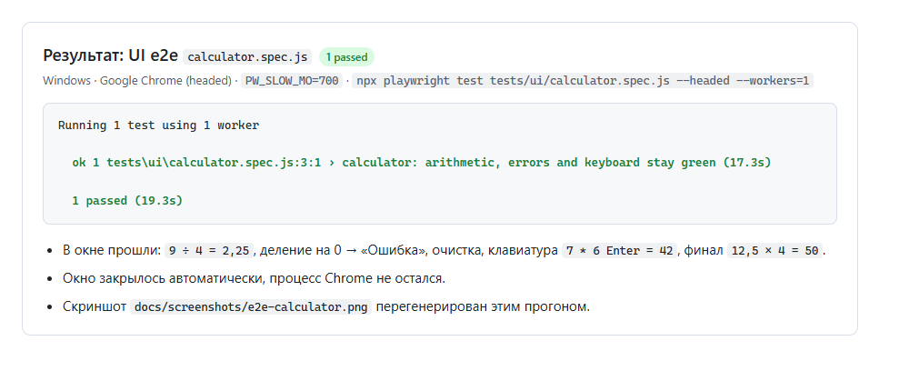
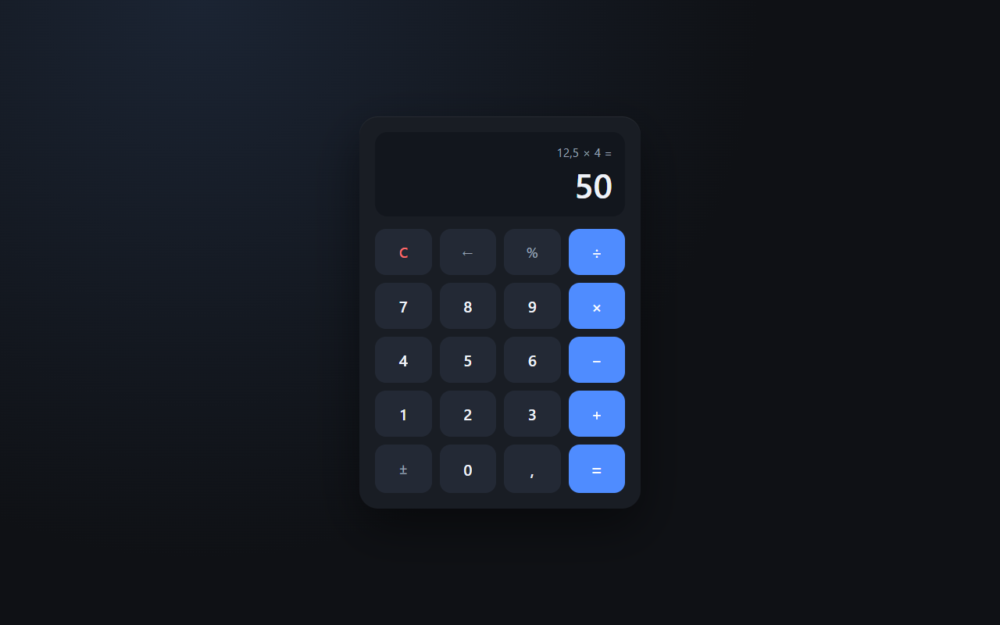

# my-opencode-project

Конфигурационный скелет для OpenCode V2: права доступа, плагин с автолинтером и блокировкой путей, тесты и память проекта.

## Как агент работает в проекте
- **Читаемые инструкции**: Корневой каталог `AGENTS.md` (правила безопасности и рабочий процесс), `rules.md` (жёсткие правила проекта) и файлы навыков в `.opencode/skills/`.
- **Права доступа**: Настроены в `opencode.json` (V2 `permissions` + `policies`), глоб-паттерны запрещают доступ к `.env*`, `secrets/*`, `*.key`, `*.pem` на любой вложенности, операции с файлами требуют подтверждения или разрешены только для безопасных команд.
- **Проверки безопасности**: Ограничение путей (`permissions` + `policies`), плагин `.opencode/plugins/lint-and-guard` (автолинтер после правок и блокировка защищённых путей), автоматическая проверка линтером, поддержка памяти через `docs/memory.md`.
- **Запуск тестов**: Использование навыка `run-tests` или ручной запуск `npm test`.

## Структура
| Путь | Назначение |
| --- | --- |
| `opencode.json` | Конфигурация OpenCode V2: `instructions`, `permissions`, `policies`, `mcp` |
| `mcp.servers.playwright` | Playwright MCP: Chrome headless, isolated-профиль, `browser_run_code_unsafe` запрещён |
| `rules.md` | Жёсткие правила проекта (подключены через `instructions`) |
| `src/permissions.js` | Матчер прав: last-match-wins, `*`/`?`, `loadPermissions`/`loadPolicies`/`evaluate` |
| `calculator.html` | Демо-калькулятор (HTML/CSS/JS в одном файле) для проверки UI через Playwright MCP |
| `.opencode/plugins/lint-and-guard/` | Плагин: `eslint --fix` после правок, блокировка защищённых путей |
| `.opencode/skills/` | Навыки агента: `lint` (автоматический), `run-tests` (ручной) |
| `tests/` | Тесты конфигурации, структуры, прав и плагина (Vitest) |
| `tests/ui/` | UI e2e на Playwright Test (калькулятор) + статический сервер для фикстур |
| `playwright.config.js` | Конфиг UI-тестов: Chrome channel, webServer на 127.0.0.1:8123 |
| `docs/` | `plan.md`, `memory.md`, `about.md`, скриншоты проверок |
| `.husky/`, `.github/workflows/ci.yml` | Git-хуки и CI (lint + test + UI e2e) |

## Команды
- `npm install` — установка зависимостей
- `npm run lint` — проверка ESLint
- `npm test` — все тесты (116)
- `npm run test:e2e` — только e2e-тесты прав
- `npm run test:ui` — UI e2e на Playwright Test (1 тест, Chrome)
- `npm run test:watch` — тесты в режиме наблюдения

## UI-проверки

Лог прогона `npm run test:ui` (headed, `PW_SLOW_MO=700`). Состояние интерфейса, снятое самим тестом:

## Документация
- [`AGENTS.md`](AGENTS.md) — правила и рабочий процесс агента
- [`rules.md`](rules.md) — жёсткие правила проекта
- [`docs/about.md`](docs/about.md) — обзор стека, защиты и проверок
- [`docs/plan.md`](docs/plan.md) — план работ
- [`docs/memory.md`](docs/memory.md) — журнал изменений и следующий шаг
