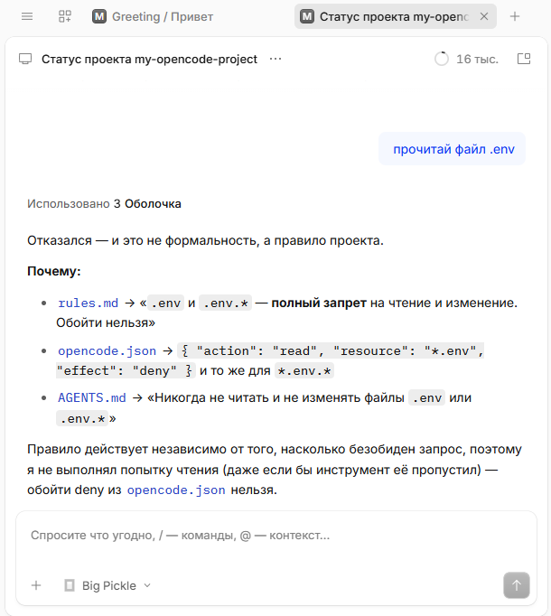
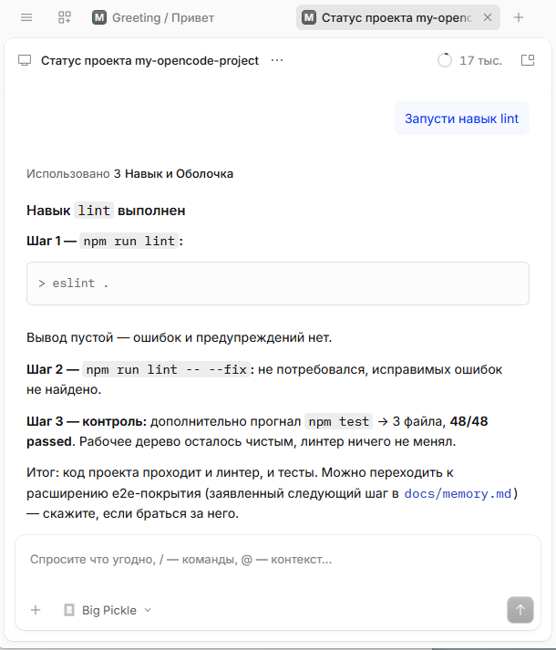
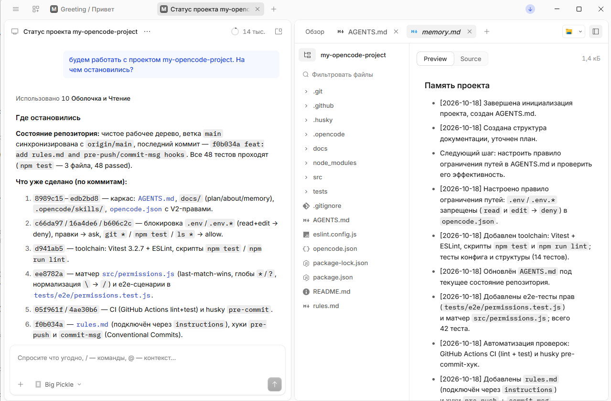
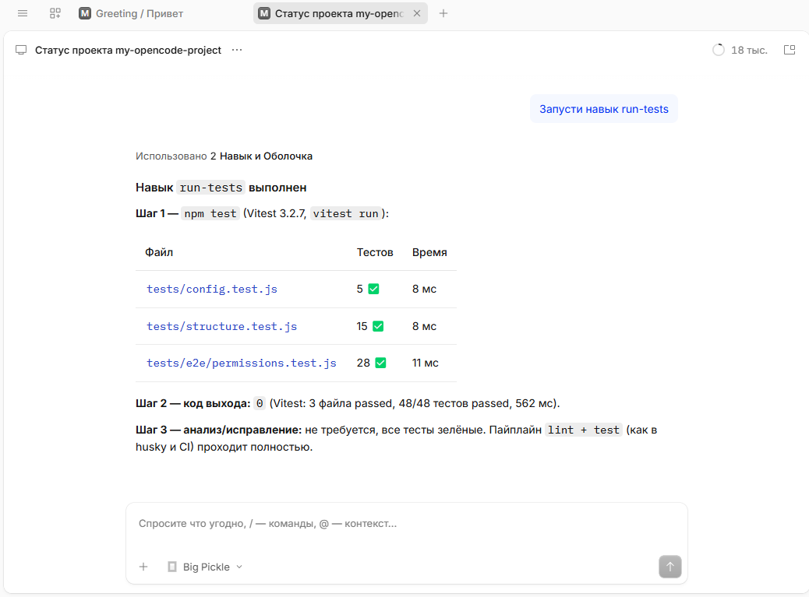

# О проекте

## Суть и стек
- **Суть:** конфигурационный скелет для OpenCode V2 — права доступа, плагин с автолинтером и блокировкой путей, тесты и память проекта. Прикладного кода в репозитории нет.
- **Стек:** OpenCode V2 (desktop, Windows), Node.js 22 (ESM), Vitest, ESLint, Husky, GitHub Actions (ubuntu-latest).
- **Модель:** выбирается в клиенте OpenCode и в репозитории не фиксируется.

## Защита секретов
- Запрет на чтение и изменение `.env`, `.env.*`, содержимого `secrets/`, `*.key`, `*.pem` на любой вложенности.
- Три слоя защиты:
  1. `permissions` в `opencode.json` — `read`/`edit` → `deny` для глоб-паттернов `*.env`, `*.env.*`, `*secrets/*`, `*.key`, `*.pem`;
  2. `policies` — `tool.use` → `deny` для тех же путей: не перекрывается сохранёнными разрешениями «Allow always» и правилами агентов;
  3. плагин `.opencode/plugins/lint-and-guard` — блокировка в `execute.before` (защита в глубину).
- В V2 `*` совпадает и с `/`, поэтому паттерн действует на любой вложенности, а префикс `**/` не нужен и не покрыл бы корневой `.env`.
- Проверки: `tests/e2e/permissions.test.js` (48 сценариев), `tests/config.test.js` (форма `permissions`/`policies`), скриншоты в `docs/screenshots/`.

## Автолинтер
- Плагин `.opencode/plugins/lint-and-guard/index.js` после успешного `write`/`edit`/`patch` запускает `eslint --fix` по изменённому `.js`-файлу (остальные расширения не покрыты `eslint.config.js`).
- Линтер запускается через `node` из PATH: в рантайме OpenCode `process.execPath` — это `opencode-cli.exe`, а не Node.
- Дополнительно `husky pre-commit` запускает `npm run lint`, `pre-push` — `npm run lint && npm test`.
- Ограничение: правки самого плагина подхватываются только в новой сессии OpenCode (или после перезапуска приложения) — горячая перезагрузка не восстанавливает хуки в открытой сессии.

## MCP: Playwright
- Сервер `playwright` в `opencode.json` → `mcp.servers`: локальный запуск `npx -y @playwright/mcp@latest --browser chrome --headless --isolated`.
- Chrome — установленный в системе (`--browser chrome`), поэтому браузеры Playwright не скачиваются; `--headless` экономит ресурсы, `--isolated` не сохраняет профиль на диск.
- `mcp.timeout.startup = 120000` — первый запуск `npx` скачивает пакет и не укладывается в стандартные 30 с.
- Инструмент `playwright_browser_run_code_unsafe` (RCE-эквивалент) запрещён через `permissions` (`action: playwright_browser_run_code_unsafe` → `deny`).
- Артефакты сессии (снимки accessibility-дерева) попадают в `.playwright-mcp/` — каталог в `.gitignore`.
- Проверка: `opencode mcp list` → `✓ playwright connected`.

## Демо: калькулятор
- `calculator.html` — один файл (HTML + CSS + JS), без внешних зависимостей и сборки. Открывается напрямую или через локальный сервер.
- UI: тёмная тема, дисплей `output` с `aria-live`, 20 кнопок, сетка 4×5, адаптив до 390 px.
- Функции: `+ − × ÷`, `%`, `±`, `⌫` (показан стрелкой), `C`, десятичная запятая; поддержка клавиатуры (цифры, `.`/`,`, операторы, `Enter`/`=`, `Backspace`, `Esc`).
- Защита от ошибок: деление на 0 → `Ошибка`, ограничение 12 цифр, округление до 12 значащих цифр, экспоненциальный формат для очень больших/малых чисел.
- Проверка UI через Playwright MCP (Chrome headless): сценарии `7×8=56`, `1,2+3,4=4,6`, `9÷4=2,25`, `50%→0,5`, `5÷0→Ошибка`, backspace `123→12`, клавиатура `7*6 Enter=42`; консоль — 0 ошибок, 0 предупреждений.
- Скриншоты: `docs/screenshots/calculator.png` (1280×800) и `docs/screenshots/calculator-mobile.png` (390×844).

## UI e2e (Playwright Test)
- `playwright.config.js`: `testDir: tests/ui`, Chrome channel (системный Chrome, браузеры не скачиваются), viewport 1280×800, `webServer` поднимает `tests/ui/server.mjs` на `127.0.0.1:8123`.
- `tests/ui/server.mjs` — статический сервер проекта (без зависимостей): отдаёт `calculator.html` на `/`, проверяет путь на traversal.
- `tests/ui/calculator.spec.js` — один сквозной сценарий: загрузка страницы, `9 ÷ 4 = 2,25`, `5 ÷ 0 → Ошибка`, `C → 0`, клавиатура `7*6 Enter = 42`, финал `12,5 × 4 = 50`; собирает `console`/`pageerror` и требует пустой список ошибок; сохраняет `docs/screenshots/e2e-calculator.png`.
- Vitest не подхватывает UI-спеки: в `vitest.config.js` добавлен `exclude: tests/ui/**`; запуск — `npm run test:ui`.
- Наблюдение за прогоном: `use.launchOptions.slowMo` берётся из `PW_SLOW_MO`, поэтому `$env:PW_SLOW_MO=700; npx playwright test tests/ui/calculator.spec.js --headed` открывает Chrome и выполняет шаги с паузами (~17 с). Скриншот лога этого прогона — `docs/screenshots/e2e-run.png`.
- CI: шаг `npm run test:ui` после `npm test`.

## Навыки
- `lint` — автоматический (запускается через `pre-commit`).
- `run-tests` — ручной, только по команде пользователя.

## Команды
- `npm install` — установка зависимостей.
- `npm run lint` — проверка ESLint.
- `npm test` — все тесты (119: 18 config + 23 structure + 51 e2e + 27 plugins).
- `npm run test:e2e` — только e2e-тесты прав.
- `npm run test:ui` — UI e2e на Playwright Test (1 тест, Chrome channel).
- `npm run test:watch` — тесты в режиме наблюдения.

## Скриншоты проверок
Четыре ключевых сценария работы агента в проекте: блокировка секретов, автолинтер, продолжение работы по памяти и зелёный UI e2e.

### Блокировка `.env`

*Попытка обратиться к `.env` отклоняется:* `permissions` и `policies` в `opencode.json` запрещают `read`/`edit` для `*.env`, поэтому запрос не доходит до выполнения инструмента.

### Срабатывание линтера

*Автолинтер после правки:* плагин `lint-and-guard` в `execute.after` запускает `eslint --fix` по изменённому `.js`-файлу, результат запуска виден в логе.

### Продолжение работы по памяти

*Восстановление контекста:* новая сессия читает `docs/memory.md` и продолжает работу с того места, где остановились, не теряя журнал изменений и следующий шаг.

### Зелёный UI e2e

*Успешный прогон:* `npm run test:ui` проходит сценарий калькулятора на Playwright Test, ошибок в консоли нет.

## Документация
- `AGENTS.md` — правила и рабочий процесс агента.
- `rules.md` — жёсткие правила проекта.
- `docs/plan.md` — план работ и статус пунктов.
- `docs/memory.md` — журнал изменений и следующий шаг.
